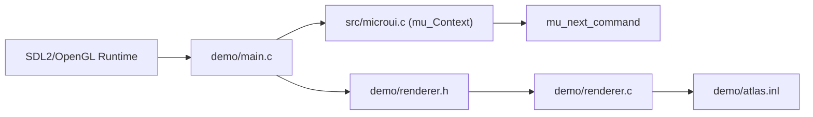

# rxi/microui

> A tiny immediate-mode UI library in ANSI C, for anyone embedding a UI in a C program.

## The problem
Embedding a graphical interface in a lightweight C program often requires a heavy framework.

## What it actually does
About 1100 lines of ANSI C handling windows, scrolling panels, buttons, sliders, text fields, labels and checkboxes within a fixed-size memory. The library draws nothing: it produces a list of commands (rectangles, text, icons, clipping) that the caller renders with its own engine.

## How it is wired


## Trying it
```c
if (mu_begin_window(ctx, "My Window", mu_rect(10, 10, 140, 86))) {
  mu_layout_row(ctx, 2, (int[]) { 60, -1 }, 0);
  mu_label(ctx, "First:");
  mu_end_window(ctx);
}
```
Usage instructions are in `doc/usage.md`, an example in the `demo` folder.

## Cost and gotchas
Free. You must supply input and rendering yourself. Last push in August 2024, a single author.

## What it is not
Not a ready-made interface: no rendering included (the demo uses SDL and OpenGL). No rich themes.

## Alternatives
No alternative named in the README.

## For you
Ignore: a native C UI has no place in a data, AI or MLOps workflow.
