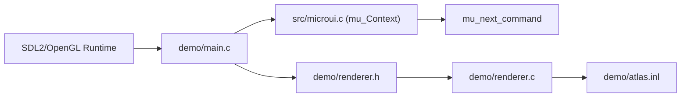

# rxi/microui

> Une minuscule bibliothèque d'interface en mode immédiat, en C ANSI, pour qui intègre une UI dans un programme C.

## Le problème
Embarquer une interface graphique dans un programme C léger impose souvent un gros framework.

## Ce que ça fait vraiment
Environ 1100 lignes de C ANSI qui gèrent fenêtres, panneaux défilants, boutons, curseurs, champs texte, étiquettes et cases à cocher dans une mémoire de taille fixe. La bibliothèque ne dessine rien : elle produit une liste de commandes (rectangles, texte, icônes, clipping) que l'appelant rend avec son propre moteur.

## Comment c'est branché


## Essayer
```c
if (mu_begin_window(ctx, "My Window", mu_rect(10, 10, 140, 86))) {
  mu_layout_row(ctx, 2, (int[]) { 60, -1 }, 0);
  mu_label(ctx, "First:");
  mu_end_window(ctx);
}
```
Les instructions d'usage sont dans `doc/usage.md`, un exemple dans le dossier `demo`.

## Coût et pièges
Gratuit. Il faut fournir soi-même l'entrée et le rendu. Dernier push en août 2024, un seul auteur.

## Ce que ce n'est pas
Pas une interface prête à l'emploi : aucun rendu inclus (la démo utilise SDL et OpenGL). Pas de thèmes riches.

## Alternatives
Aucune alternative nommée dans le README.

## Pour toi
À ignorer : une UI native en C n'a pas de place dans un flux data, IA ou MLOps.

