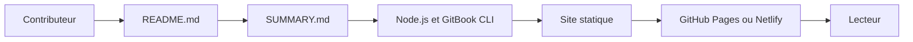

# ryanhanwu/How-To-Ask-Questions-The-Smart-Way

> Traditional Chinese translation of Eric Raymond's guide on the art of asking technical questions.

## The problem
Poorly worded technical questions go unanswered and waste the time of the volunteers who read them.

## What it actually does
The text explains what to do before asking a question (search, read the manual, the FAQ, the code), how to choose the forum or mailing list, write an "objective — difference" title, describe symptoms and environment, provide a minimal example, then say thanks and report the resolution. It gives examples of good and bad questions.

## How it is wired

## Trying it
No command: it is a text to read.

## Cost and gotchas
Free. The content is in Traditional Chinese; the last push dates from 2025-01-01, more than a year ago. The original tone is very blunt.

## What it is not
Not a general etiquette guide: the authors state that it only covers getting useful answers on a technical forum. Not a support service either.

## Alternatives
No alternative named in the README (it points to the original English version and to the Simplified Chinese version).

## For you
Ignore the Chinese version if you do not read the language; the substance remains useful, but consult the English original instead.
