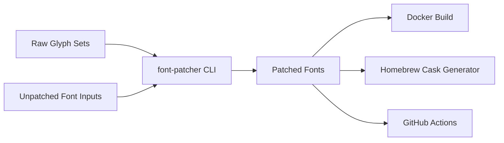

# ryanoasis/nerd-fonts

> Programming fonts enriched with thousands of icons, with a tool to patch your own.

## The problem
Terminal prompts and editor plugins display icons that ordinary fonts do not contain.

## What it actually does
Offers 67 pre-patched font families and more than 10,000 glyphs (Font Awesome, Material Design, Octicons, Powerline, Codicons…). The `font-patcher` script (Python and FontForge) adds these glyphs to a font of your choice, in monospace or proportional versions. Installation by archive, Homebrew, script, Scoop or Chocolatey.

## How it is wired


## Trying it
```sh
brew install font-hack-nerd-font
./install.sh install Hack
fontforge -script font-patcher PATH_TO_FONT
```

## Cost and gotchas
Free. Cloning the whole repository is discouraged (size); paths on the `master` branch are not stable, so reference a release. The patcher requires FontForge and Python 3.

## What it is not
Not a new font: these are existing fonts, modified, with their original licenses. The repository has no single license identified by GitHub.

## Alternatives
No alternative named in the README.

## For you
Ignore for data / AI watch; only useful for a comfortable terminal, often required by Starship.
