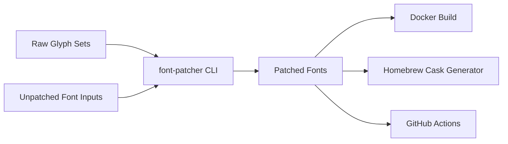

# ryanoasis/nerd-fonts

> Polices de programmation enrichies de milliers d'icônes, avec un outil pour patcher les siennes.

## Le problème
Les prompts de terminal et plugins d'éditeur affichent des icônes que les polices usuelles ne contiennent pas.

## Ce que ça fait vraiment
Propose 67 familles de polices déjà patchées et plus de 10 000 glyphes (Font Awesome, Material Design, Octicons, Powerline, Codicons…). Le script `font-patcher` (Python et FontForge) ajoute ces glyphes à une police au choix, en versions monospace ou proportionnelles. Installation par archive, Homebrew, script, Scoop ou Chocolatey.

## Comment c'est branché


## Essayer
```sh
brew install font-hack-nerd-font
./install.sh install Hack
fontforge -script font-patcher PATH_TO_FONT
```

## Coût et pièges
Gratuit. Cloner tout le dépôt est déconseillé (taille) ; les chemins de la branche `master` ne sont pas stables, il faut référencer une version. Le patcher exige FontForge et Python 3.

## Ce que ce n'est pas
Pas une police nouvelle : ce sont des polices existantes modifiées, avec leurs licences d'origine. Le dépôt n'a pas de licence unique identifiée par GitHub.

## Alternatives
Aucune alternative nommée dans le README.

## Pour toi
À ignorer pour la veille data / IA ; utile seulement pour un terminal confortable, souvent requis par Starship.

