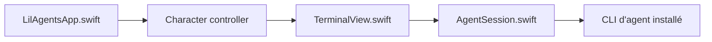

# ryanstephen/lil-agents

> Little animated characters on the macOS Dock that open a terminal to chat with an AI agent.

## The problem
No real problem: it is a playful interface for launching agent CLIs from the Dock.

## What it actually does
Two characters (Bruce and Jazz) walk above the Dock; a click opens a popover terminal wired to Claude Code, Codex, Copilot or Gemini CLI, chosen from the menu bar. Four themes, `/clear`, `/copy`, `/help` commands, "thinking" bubbles, sounds. No data collected by the app; updates via Sparkle.

## How it is wired


## Trying it
```bash
# Ouvrir lil-agents.xcodeproj dans Xcode puis lancer
npm install -g @openai/codex
npm install -g @google/gemini-cli
brew install copilot-cli
```

## Cost and gotchas
Free, but at least one agent CLI must be installed, with its own account or subscription. macOS 14+.

## What it is not
Not an agent: it dresses up existing CLIs. Last push in April 2026.

## Alternatives
No alternative named in the README.

## For you
Ignore: an interface gadget with no value for data/MLOps work, and little activity since April.
