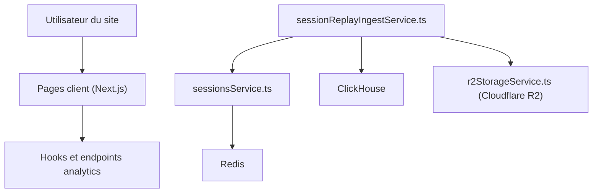

# rybbit-io/rybbit

> Open source alternative to Google Analytics, cookie-free, self-hostable, with session replays.

## The problem
Google Analytics is opaque and data-hungry; free alternatives offer few advanced features.

## What it actually does
Collects sessions, page views, custom events, replays, funnels, retention, journeys, errors and Web Vitals. Offers a real-time dashboard and maps. The code shows ClickHouse storage, sessions in Redis and optional replays on Cloudflare R2. The wiring of several features is not established in the excerpt.

## How it is wired

## Trying it
No command is documented in the supplied README: it points to the online documentation for installation and to the pnpm workspace for development.

## Cost and gotchas
Hosted version or self-hosting on your own server. Web Vitals are reserved for the paid cloud according to the README. The stack (ClickHouse, Redis) makes hosting heavier. 205 open issues.

## What it is not
It is not a general-purpose data analysis tool: it is website analytics. The comparison table comes from the author.

## Alternatives
- Plausible: cited in the comparison, limited community edition.
- GA4: cited in the comparison, but closed.

## For you
Worth watching if you need to measure the usage of an app or ML dashboard without cookies; otherwise outside your core work. AGPL license: be careful if you embed it.
