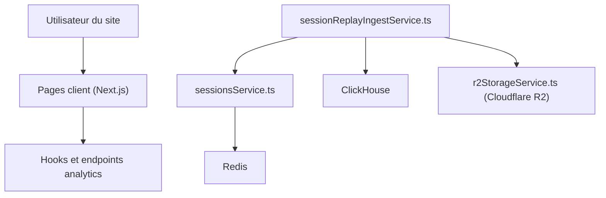

# rybbit-io/rybbit

> Alternative open source à Google Analytics, sans cookies, auto-hébergeable, avec replays de sessions.

## Le problème
Google Analytics est opaque et gourmand en données ; les alternatives libres offrent peu de fonctions avancées.

## Ce que ça fait vraiment
Collecte sessions, pages vues, événements personnalisés, replays, entonnoirs, rétention, parcours, erreurs et Web Vitals. Offre un tableau de bord temps réel et des cartes. Le code montre un stockage ClickHouse, des sessions dans Redis et des replays en option sur Cloudflare R2. Le câblage de plusieurs fonctions n'est pas établi dans l'extrait.

## Comment c'est branché

## Essayer
Aucune commande n'est documentée dans le README fourni : il renvoie à la documentation en ligne pour l'installation et à l'espace de travail pnpm pour le développement.

## Coût et pièges
Version hébergée ou auto-hébergement sur ton propre serveur. Les Web Vitals sont réservés au cloud payant selon le README. La pile (ClickHouse, Redis) alourdit l'hébergement. 205 issues ouvertes.

## Ce que ce n'est pas
Ce n'est pas un outil d'analyse de données généraliste : c'est de l'analytics de site web. Le tableau comparatif vient de l'auteur.

## Alternatives
- Plausible : cité dans le comparatif, édition communautaire limitée.
- GA4 : cité dans le comparatif, mais fermé.

## Pour toi
À surveiller si tu dois mesurer l'usage d'une appli ou d'un dashboard ML sans cookies ; sinon hors cœur de métier. Licence AGPL : attention si tu l'intègres.

