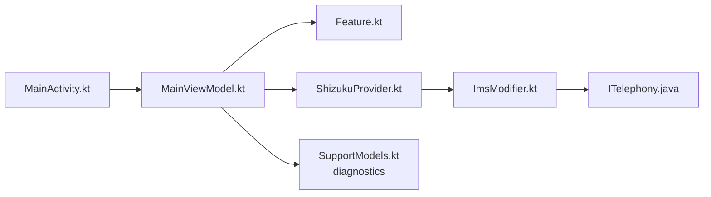

# ryfineZ/carrier-ims-for-pixel

> Android app that configures VoLTE, VoWiFi, VoNR and 5G display on Google Pixel phones via Shizuku.

## The problem
On Pixel, some carriers do not enable VoLTE/VoWiFi/VoNR or the 5G display, and diagnosing IMS registration is opaque.

## What it actually does
The app, a fork of Mystery00/TurboIMS, writes CarrierConfig overrides with Shizuku privileges: toggles for VoLTE, VoWiFi, ViLTE, VoNR, UT, Cross-SIM, 5G icons. It adds manual IMS registration, network validation repair (captive portal), logs and issue submission. A "TikTok" option exists for Chinese SIMs; the README specifies that it exploits an abnormal country code on TikTok's side and is not a real carrier modification.

## How it is wired


## Trying it
```bash
./gradlew :app:assembleDebug
adb install -r app/build/outputs/apk/debug/app-debug.apk
```
Otherwise: install the APK from Releases, start Shizuku, authorize the app, choose the SIM.

## Cost and gotchas
Free; requires Shizuku, a Tensor Pixel (6 to 10, Fold, Tablet) and Android 13+. The settings modify the carrier config: risk of losing service. 213 open issues. README in Chinese first.

## What it is not
Not a tool to change carrier or country: the README itself says the country code is not actually modified. The TikTok workaround depends on the target application and may violate its terms of use. Reserve it for your own devices.

## Alternatives
`Mystery00/TurboIMS` (upstream), `vvb2060/Ims`, `kyujin-cho/pixel-volte-patch` (acknowledged in the README).

## For you
Ignore: a telecom tinkering tool for Pixel, unrelated to data, AI or MLOps.
