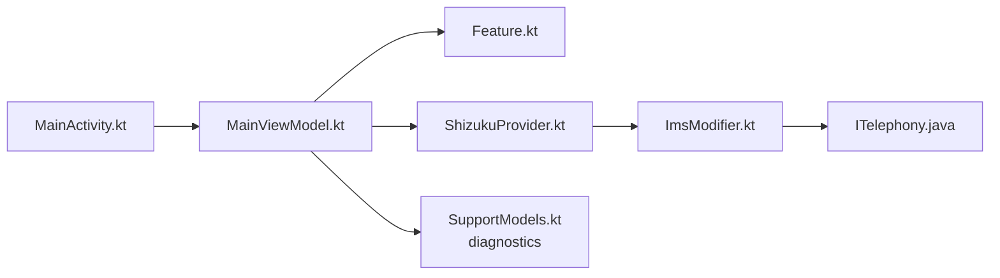

# ryfineZ/carrier-ims-for-pixel

> Application Android qui règle VoLTE, VoWiFi, VoNR et l'affichage 5G sur les Google Pixel via Shizuku.

## Le problème
Sur Pixel, certains opérateurs n'activent pas VoLTE/VoWiFi/VoNR ou l'affichage 5G, et diagnostiquer l'enregistrement IMS est opaque.

## Ce que ça fait vraiment
L'app, fork de Mystery00/TurboIMS, écrit des surcharges de CarrierConfig avec les droits Shizuku : bascules VoLTE, VoWiFi, ViLTE, VoNR, UT, Cross-SIM, icônes 5G. Elle ajoute enregistrement IMS manuel, réparation de la validation réseau (captive portal), journaux et envoi d'issues. Une option « TikTok » existe pour les SIM chinoises ; le README précise qu'elle exploite un code pays anormal côté TikTok et n'est pas une vraie modification de l'opérateur.

## Comment c'est branché


## Essayer
```bash
./gradlew :app:assembleDebug
adb install -r app/build/outputs/apk/debug/app-debug.apk
```
Sinon : installer l'APK des Releases, démarrer Shizuku, autoriser l'app, choisir la SIM.

## Coût et pièges
Gratuit ; nécessite Shizuku, un Pixel Tensor (6 à 10, Fold, Tablet) et Android 13+. Les réglages modifient la config opérateur : risque de perte de service. 213 issues ouvertes. README en chinois d'abord.

## Ce que ce n'est pas
Pas un outil pour changer d'opérateur ni de pays : le README dit lui-même que le code pays n'est pas réellement modifié. Le contournement TikTok dépend de l'application cible et peut enfreindre ses conditions d'usage. À réserver à ses propres appareils.

## Alternatives
`Mystery00/TurboIMS` (amont), `vvb2060/Ims`, `kyujin-cho/pixel-volte-patch` (remerciés dans le README).

## Pour toi
À ignorer : outil de bidouille télécom pour Pixel, sans lien avec data, IA ou MLOps.

