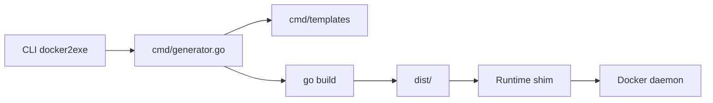

# rzane/docker2exe

> Converts a Docker image into an executable to send to colleagues, without them having to handle Docker.

## The problem
Sharing a tool packaged as a Docker image forces the recipient to know the `docker pull` and `docker run` commands.

## What it actually does
A Go program generates a mini-project from templates (`cmd/templates`), then compiles it for darwin, linux and windows into `dist/`. At launch, the executable checks that the image is present and runs `docker pull`. In `--embed` mode, the image is saved as a compressed archive and embedded in the binary.

## How it is wired


## Trying it
```bash
docker2exe --name alpine --image alpine:3.9
dist/alpine-darwin-amd64 cat /etc/alpine-release
docker2exe --name alpine --image alpine:3.9 --embed
```

## Cost and gotchas
Docker is required on the build and execution machine; Go and gzip to build. The embedded mode suits small images (example under 10 MB).

## What it is not
It is not real standalone packaging: the recipient must have Docker. No license declared, so usage rights are uncertain.

## Alternatives
- No alternative named in the README.

## For you
Ignore: little maintained (last push 2025-05-06), unlicensed, and Docker is still required on the recipient's side.
