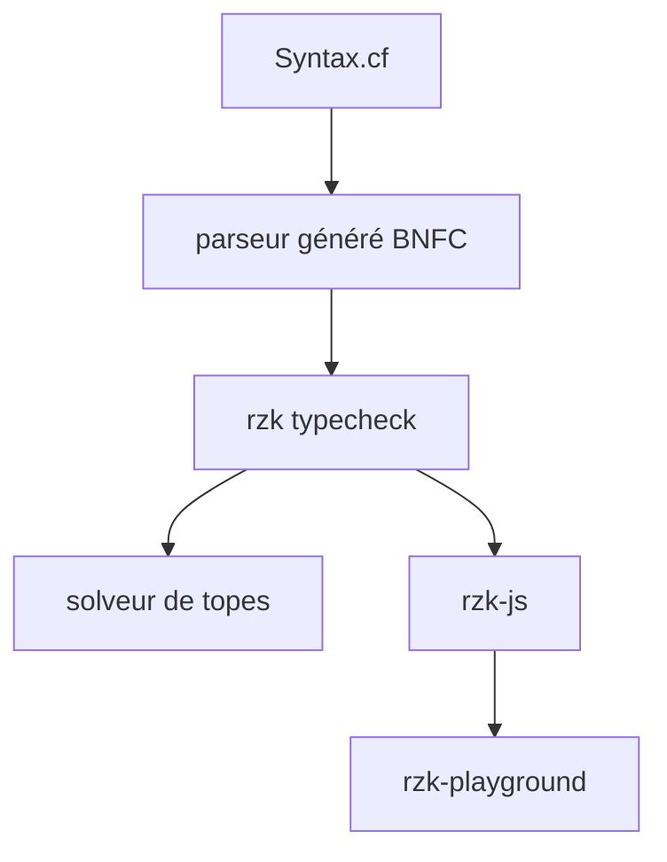

# rzk-lang/rzk

> Experimental proof assistant for synthetic ∞-categories, for type theory researchers.

## The problem
Mechanizing the formalizations of Riehl and Shulman (type theory with shapes) requires a dedicated checker.

## What it actually does
A typechecker in Haskell: `rzk typecheck` checks `.rzk` or `.rzk.md` files in the given order, `rzk format` formats them. It includes a tope solver, an online playground, two browser games and a VS Code extension (syntax highlighting).

## How it is wired
Simplified diagram based on the sheet, no diagram provided.


## Trying it
```bash
cabal update
cabal install rzk
rzk typecheck first.rzk second.rzk third.rzk
rzk format --write examples/*.rzk
```

## Cost and gotchas
Haskell toolchain (cabal/stack) or nix. Files must be listed in the right order. License: none declared by the catalog.

## What it is not
Not a general-purpose proof assistant like those of mainstream formal proof: it targets one specific theory. Prototype.

## Alternatives
No alternative named in the README.

## For you
Ignore: type theory research, no data/AI/MLOps application, and no declared license.
