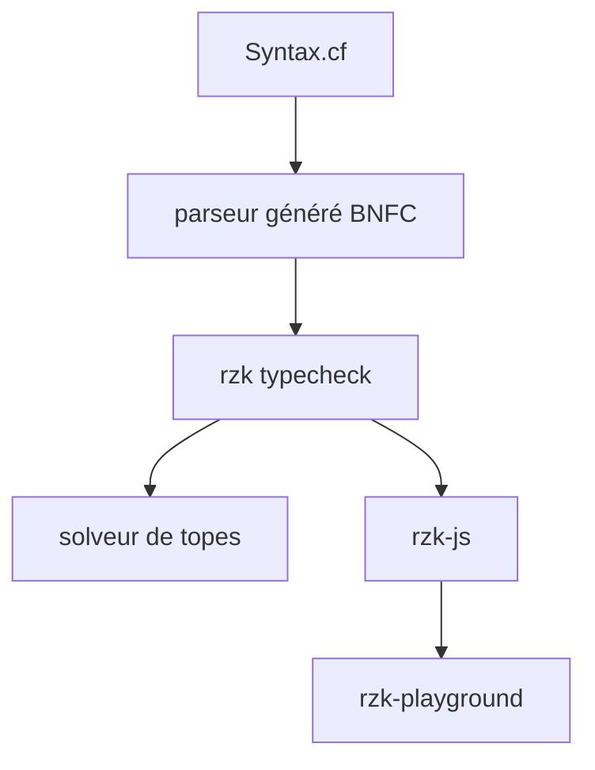

# rzk-lang/rzk

> Assistant de preuve expérimental pour les ∞-catégories synthétiques, pour chercheurs en théorie des types.

## Le problème
Mécaniser les formalisations de Riehl et Shulman (théorie des types avec formes) demande un vérificateur dédié.

## Ce que ça fait vraiment
Un typechecker en Haskell : `rzk typecheck` vérifie des fichiers `.rzk` ou `.rzk.md` dans l'ordre donné, `rzk format` les met en forme. Il inclut un solveur de topes, un playground en ligne, deux jeux navigateur et une extension VS Code (coloration syntaxique).

## Comment c'est branché
Schéma simplifié d'après la fiche, sans diagramme fourni.


## Essayer
```bash
cabal update
cabal install rzk
rzk typecheck first.rzk second.rzk third.rzk
rzk format --write examples/*.rzk
```

## Coût et pièges
Chaîne Haskell (cabal/stack) ou nix. Les fichiers doivent être listés dans le bon ordre. Licence : aucune déclarée par le catalogue.

## Ce que ce n'est pas
Pas un assistant de preuve généraliste comme ceux de la preuve formelle courante : il vise une théorie précise. Prototype.

## Alternatives
Aucune alternative nommée dans le README.

## Pour toi
Ignorer : recherche en théorie des types, sans application data/IA/MLOps, et sans licence déclarée.

