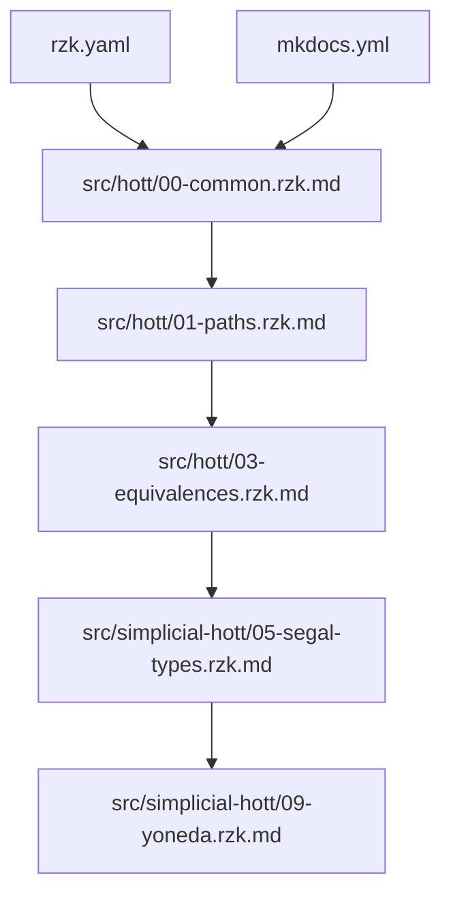

# rzk-lang/sHoTT

> Formalization library in simplicial homotopy type theory, for the theory of ∞-categories.

## The problem
Machine-checking results of synthetic ∞-category theory drawn from several research papers.

## What it actually does
`.rzk.md` files formalize homotopy type theory, then simplicial types, up to the Yoneda lemma. The experimental `rzk` proof assistant checks them. An MkDocs site publishes the files with syntax highlighting.

## How it is wired


## Trying it
```bash
rzk typecheck
```

## Cost and gotchas
The `rzk` proof assistant must be installed. No license declared: reuse is uncertain.

## What it is not
Not a programming library nor a data tool: it is a corpus of mathematical proofs.

## Alternatives
No alternative named in the README.

## For you
Ignore: formal mathematics with no use in data, AI or MLOps work.
