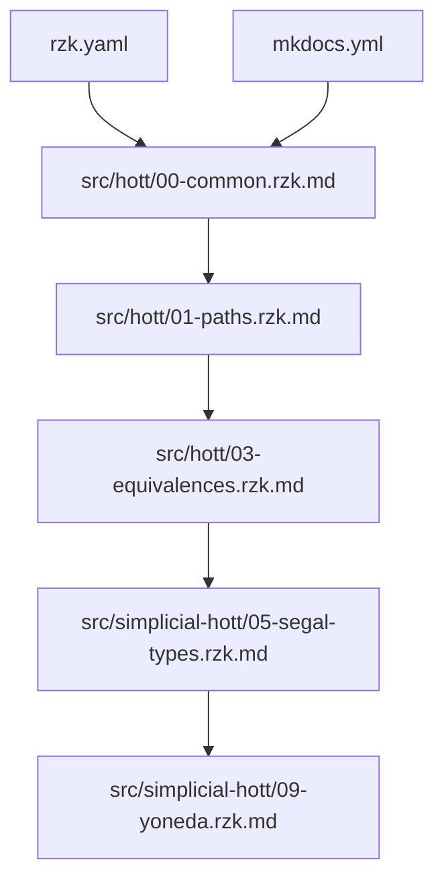

# rzk-lang/sHoTT

> Bibliothèque de formalisation en théorie des types homotopiques simpliciaux, pour la théorie des ∞-catégories.

## Le problème
Vérifier par machine des résultats de théorie des ∞-catégories synthétiques tirés de plusieurs articles de recherche.

## Ce que ça fait vraiment
Des fichiers `.rzk.md` formalisent la théorie des types homotopiques, puis les types simpliciaux, jusqu'au lemme de Yoneda. L'assistant de preuve `rzk`, expérimental, les vérifie. Un site MkDocs publie les fichiers avec coloration syntaxique.

## Comment c'est branché


## Essayer
```bash
rzk typecheck
```

## Coût et pièges
Il faut installer l'assistant de preuve `rzk`. Aucune licence déclarée : réutilisation incertaine.

## Ce que ce n'est pas
Pas une bibliothèque de programmation ni un outil de data : c'est un corpus de preuves mathématiques.

## Alternatives
Aucune alternative nommée dans le README.

## Pour toi
À ignorer : mathématiques formelles sans usage dans un travail data, IA ou MLOps.

