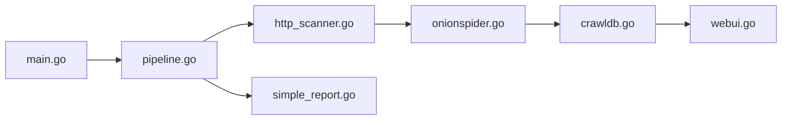

# s-rah/onionscan

> Tor hidden service scanner: anonymity leaks for operators, correlations for researchers.

## The problem
.onion services often betray their operators through configuration mistakes, not through flaws in Tor.

## What it actually does
Takes a .onion address, goes through Tor's SOCKS proxy, runs scans and a web crawl, extracts identities (including Bitcoin addresses), then produces a simple or JSON report. A web interface, the "Correlation Lab", lets you search and label correlations.

## How it is wired


## Trying it
```bash
go get github.com/s-rah/onionscan
onionscan notarealhiddenservice.onion
onionscan --verbose notarealhiddenservice.onion
onionscan --jsonReport notarealhiddenservice.onion
onionscan --torProxyAddress=127.0.0.1:9150 notarealhiddenservice.onion
```

## Cost and gotchas
Free. The README requires Go 1.6 or 1.7: very old. Last push in August 2024.

## What it is not
Not a recommended mass deanonymization tool; its authors say they disapprove of certain investigations. License "present but not identified".

## Alternatives
None cited in the README.

## For you
Outside the data/AI scope, old and poorly maintained code base: ignore.
