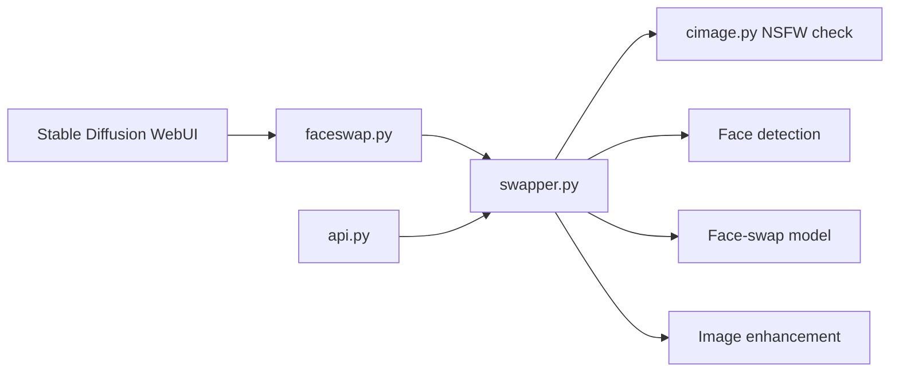

# s0md3v/roop

> Archived extension for the AUTOMATIC1111 Stable Diffusion web interface: replaces a face in a generated image with another one.

## The problem
Replacing a face in a generated image otherwise requires training a dedicated model. This extension avoids that with a simple reference image.

## What it actually does
- Hooks into the Stable Diffusion web interface through a script (`faceswap.py`): you provide an image containing a face, tick "Enable", and the generated result carries that face.
- The engine (`swapper.py`) checks the content of the target (`cimage.py`), detects faces, applies the swap model (`inswapper_128.onnx`), then restores or upscales the image.
- An API (`api.py`) exposes image swapping and the list of models.
- The author stopped development and archived the repository: he says his view of the side effects of this kind of software has changed.

## How it is wired


## Trying it
```bash
pip install insightface==0.7.3
# puis, dans web-ui : onglet Extensions > « install from URL »
# https://github.com/s0md3v/sd-webui-roop
# relancer web-ui ; si erreur 'NoneType' : placer inswapper_128.onnx dans /models/roop/
```

## Cost and gotchas
On Windows, Visual Studio with the Python and C++ packages is required. The repository is archived: no fixes to expect, and the 139 issues remain unanswered.

## What it is not
It is not a maintained tool. It produces deepfakes: the README asks you to respect local law, obtain the consent of the person whose face is used, and label the content as synthetic. The built-in content filter is partial protection, not a guarantee. AGPL-3.0 license: obligation to publish the code if offered as a network service.

## Alternatives
No alternative named in the README (it says it is based on the original roop project, developed separately).

## For you
Ignore: archived by its author for ethical reasons, unmaintained, and legally sensitive to use; only worth looking at as a historical reference for a face-swap pipeline.
