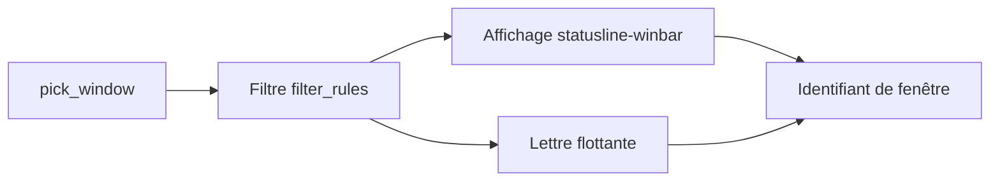

# s1n7ax/nvim-window-picker

> Neovim plugin that lets you pick a window with a letter and returns its identifier.

## The problem
With many windows open, targeting one of them from the keyboard takes repeated movements.

## What it actually does
Shows a letter on each window (status bar, title bar or floating letter) and returns the identifier of the one you type. Filters by file type and buffer type. Serves as a building block for other plugins.

## How it is wired
Simplified diagram based on the sheet, no diagram provided.


## Trying it
```lua
{
  's1n7ax/nvim-window-picker',
  name = 'window-picker',
  event = 'VeryLazy',
  version = '2.*',
  config = function() require'window-picker'.setup() end,
}
```

## Cost and gotchas
Free. The last commit dates from February 2025. Version 2 changed how `selection_display` renders.

## What it is not
Not a window manager nor a standalone tool: a function to call from a configuration.

## Alternatives
No alternative named in the README.

## For you
Ignore: a minor editor convenience, no value for data/AI/MLOps, and barely active for a year.
