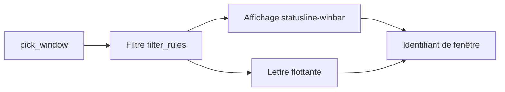

# s1n7ax/nvim-window-picker

> Extension Neovim qui te laisse choisir une fenêtre par une lettre et renvoie son identifiant.

## Le problème
Avec beaucoup de fenêtres ouvertes, désigner l'une d'elles au clavier demande des déplacements répétés.

## Ce que ça fait vraiment
Affiche une lettre sur chaque fenêtre (barre d'état, barre de titre ou lettre flottante) et renvoie l'identifiant de celle que tu tapes. Filtres par type de fichier et de tampon. Sert de brique à d'autres extensions.

## Comment c'est branché
Schéma simplifié d'après la fiche, sans diagramme fourni.


## Essayer
```lua
{
  's1n7ax/nvim-window-picker',
  name = 'window-picker',
  event = 'VeryLazy',
  version = '2.*',
  config = function() require'window-picker'.setup() end,
}
```

## Coût et pièges
Gratuit. Le dernier commit date de février 2025. La version 2 a changé le rendu de `selection_display`.

## Ce que ce n'est pas
Pas un gestionnaire de fenêtres ni un outil autonome : une fonction à appeler depuis une configuration.

## Alternatives
Aucune alternative nommée dans le README.

## Pour toi
À ignorer : micro-confort d'éditeur, sans valeur pour data/IA/MLOps, et peu actif depuis un an.

