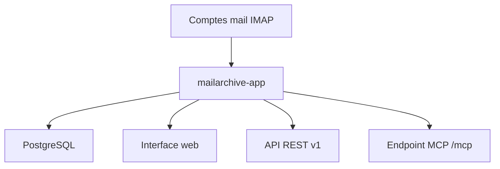

# s1t5/mail-archiver

> A self-hosted web application to archive, search and export your emails, with API and MCP.

## The problem
Mailboxes fill up, expire or become unfindable, and copying them by hand allows neither search nor compliance.

## What it actually does
It syncs several mail accounts into PostgreSQL, with filtered search, attachment preview, mbox or EML export, import, restore, migration between mailboxes and retention policies. Multi-user, OpenID Connect, access log, optional deletion lock. A read-only REST API and an MCP server expose the archive to scripts and AI agents.

## How it is wired
Simplified diagram based on the sheet, no diagram provided.


## Trying it
```bash
docker compose up -d
docker compose restart
```
A docker-compose.yml file (image s1t5/mailarchiver:latest and postgres:17-alpine) is given in the README.

## Cost and gotchas
Free, but the application does not provide HTTPS: a reverse proxy is mandatory. The passwords in the example compose must be changed. Back up the PostgreSQL database.

## What it is not
Not a mail client nor a mail server: a read-only archive. Mailbox credentials are stored in it for synchronization. The documentation is said to be still recent.

## Alternatives
No alternative named in the README.

## For you
Worth watching: useful for keeping a local mail archive queryable by an agent via MCP, but exposing your mailboxes requires a careful deployment.
