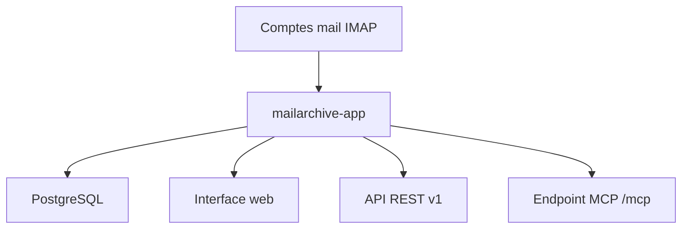

# s1t5/mail-archiver

> Une application web auto-hébergée pour archiver, chercher et exporter ses courriels, avec API et MCP.

## Le problème
Les boîtes mail se vident, expirent ou deviennent introuvables, et les copier à la main ne permet ni recherche ni conformité.

## Ce que ça fait vraiment
Elle synchronise plusieurs comptes de messagerie vers PostgreSQL, avec recherche à filtres, aperçu des pièces jointes, export mbox ou EML, import, restauration, migration entre boîtes et politiques de rétention. Multi-utilisateur, OpenID Connect, journal d'accès, option de verrouillage des suppressions. Une API REST en lecture seule et un serveur MCP exposent l'archive aux scripts et aux agents IA.

## Comment c'est branché
Schéma simplifié d'après la fiche, sans diagramme fourni.


## Essayer
```bash
docker compose up -d
docker compose restart
```
Un fichier docker-compose.yml (image s1t5/mailarchiver:latest et postgres:17-alpine) est donné dans le README.

## Coût et pièges
Gratuit, mais l'application ne fournit pas HTTPS : un proxy inverse est obligatoire. Les mots de passe du compose d'exemple sont à changer. Sauvegarder la base PostgreSQL.

## Ce que ce n'est pas
Pas un client mail ni un serveur de messagerie : un archivage en lecture. Les identifiants des boîtes y sont stockés pour la synchronisation. La documentation est dite encore récente.

## Alternatives
Aucune alternative nommée dans le README.

## Pour toi
À surveiller : utile pour garder une archive mail locale interrogeable par un agent via MCP, mais exposer ses boîtes demande un déploiement soigné.

