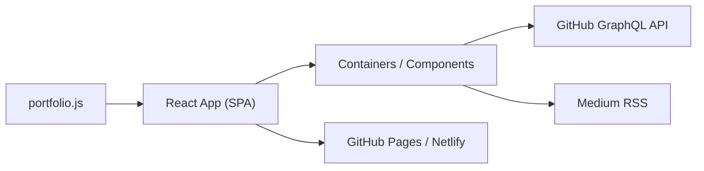

# saadpasta/developerFolio

> Responsive React portfolio template for developers, configurable through a single JavaScript file.

## The problem
Building a portfolio site from scratch takes time for a result that is often generic.

## What it actually does
You edit `src/portfolio.js` (summary, skills, experience, projects, blogs, contact) and `src/_globalColor.scss` for colors. The site can display pinned GitHub repositories (GraphQL, token in `.env`), Medium articles and a Twitter timeline. Deployment via GitHub Pages/Actions or Netlify, Docker possible.

## How it is wired


## Trying it
```bash
git clone https://github.com/saadpasta/developerFolio.git
cd developerFolio
cp env.example .env
npm install
npm start
docker build -t developerfolio:latest .
docker run -t -p 3000:3000 developerfolio:latest
```

## Cost and gotchas
Free; a GitHub token with no scopes is required to display projects. Last push in late 2024 (161 open issues), old Create React App stack (Node 10 mentioned).

## What it is not
Not a CMS: everything goes through code. GPL-3.0 license, so derivatives must be redistributed under GPL.

## Alternatives
None named in the README.

## For you
Ignore: web showcase template unrelated to your field, and not very active.
