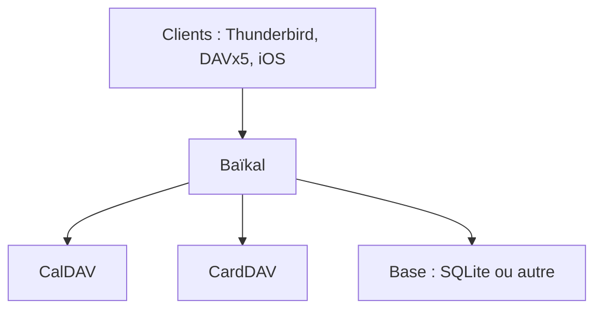

# sabre-io/Baikal

> Lightweight CalDAV and CardDAV server to self-host calendars and contacts.

## The problem
Shared calendars and contacts often depend on a third-party cloud; a standalone server avoids that.

## What it actually does
The repository is the source of the Baïkal server (CalDAV/CardDAV). Installation, update and troubleshooting are described on sabre.io/baikal. The README says nothing more about how it works. Community guides in German and French exist.

## How it is wired
Simplified diagram based on the sheet, no diagram provided.



## Trying it
```bash
php -S 127.0.0.1:8000 -t . &
BAIKAL_BASE_URL=http://127.0.0.1:8000/html/ BAIKAL_TEST_BACKENDS=sqlite python3 run_tests.py
```
These are the tests: they reset the configuration and the database, so never run them on a real installation.

## Cost and gotchas
Free, but self-hosted (PHP). GPL-3.0 license: restrictive if you redistribute modifications.

## What it is not
Not a full collaborative work tool: only calendar and contacts. No installation instructions in this README.

## Alternatives
No alternative named in the README.

## For you
Ignore: a calendar server unrelated to data, AI or MLOps work.
