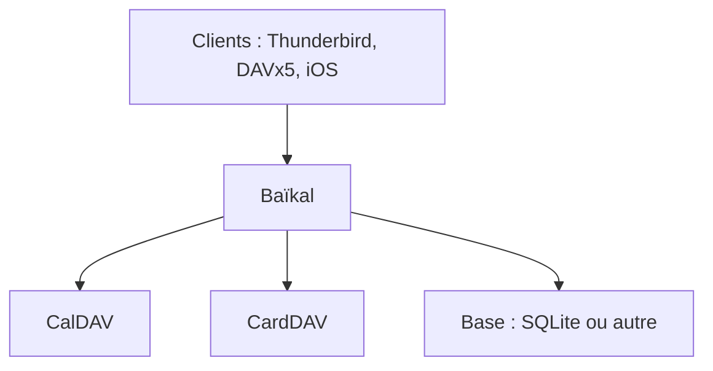

# sabre-io/Baikal

> Serveur CalDAV et CardDAV léger pour héberger soi-même calendriers et contacts.

## Le problème
Calendriers et contacts partagés dépendent souvent d'un cloud tiers ; un serveur autonome évite cela.

## Ce que ça fait vraiment
Le dépôt est la source du serveur Baïkal (CalDAV/CardDAV). Installation, mise à jour et dépannage sont décrits sur sabre.io/baikal. Le README ne dit rien de plus sur le fonctionnement. Des guides communautaires en allemand et en français existent.

## Comment c'est branché
Schéma simplifié d'après la fiche, sans diagramme fourni.



## Essayer
```bash
php -S 127.0.0.1:8000 -t . &
BAIKAL_BASE_URL=http://127.0.0.1:8000/html/ BAIKAL_TEST_BACKENDS=sqlite python3 run_tests.py
```
Ce sont les tests : ils réinitialisent configuration et base, donc jamais sur une installation réelle.

## Coût et pièges
Gratuit, mais à héberger soi-même (PHP). Licence GPL-3.0 : contraignante si vous redistribuez des modifications.

## Ce que ce n'est pas
Pas un outil de travail collaboratif complet : uniquement agenda et contacts. Pas d'instructions d'installation dans ce README.

## Alternatives
Aucune alternative nommée dans le README.

## Pour toi
À ignorer : serveur d'agenda sans rapport avec un travail data, IA ou MLOps.

