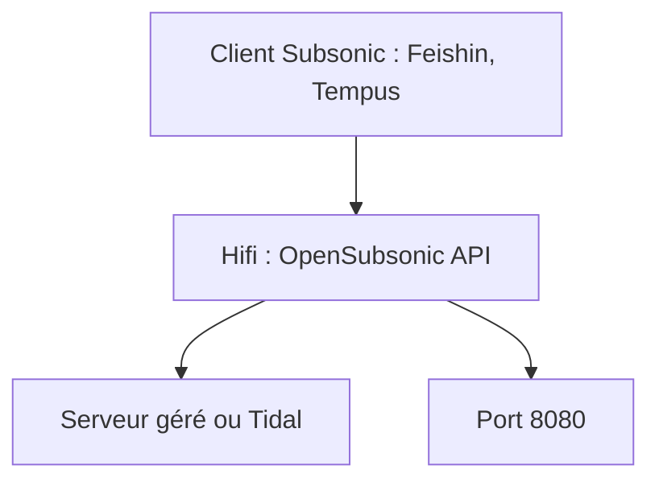

# sachinsenal0x64/hifi

> OpenSubsonic-compatible server written in Go, plugged into Tidal, to use Subsonic clients.

## The problem
Subsonic clients (Feishin, Tempus, Castafiore) cannot play Tidal without an intermediate server.

## What it actually does
A Go server that exposes the OpenSubsonic routes needed for playback only, not the whole API. The "managed" mode uses a server run by the author; values to fetch from a gist are passed as environment variables. The full self-hosted installation is marked "Pending".

## How it is wired
Simplified diagram based on the sheet, no diagram provided.



## Trying it
```bash
git clone https://github.com/sachinsenal0x64/hifi
go mod tidy
export MANAGE_HOST="value" TIDAL_HOST="value" MODE="value" CLIENT_ID="value" SCHEME="value"
go run .
```

## Cost and gotchas
A Tidal subscription is required for self-hosting. The managed server may ban you in case of abuse; Go and git must be installed.

## What it is not
Not a finished standalone server: self-hosting is not documented. It does not cover all OpenSubsonic endpoints.

## Alternatives
No alternative named in the README (only recommended clients).

## For you
Ignore: dependence on Tidal and on a server run by a single person, unrelated to your data / AI work.
