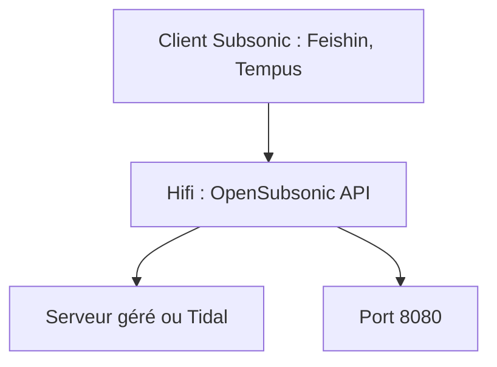

# sachinsenal0x64/hifi

> Serveur compatible OpenSubsonic écrit en Go, branché sur Tidal, pour utiliser des clients Subsonic.

## Le problème
Les clients Subsonic (Feishin, Tempus, Castafiore) ne lisent pas Tidal sans serveur intermédiaire.

## Ce que ça fait vraiment
Un serveur Go qui expose les routes OpenSubsonic nécessaires à la lecture seulement, pas toute l'API. Le mode « managed » utilise un serveur géré par l'auteur ; des valeurs à récupérer dans un gist sont passées en variables d'environnement. L'installation auto-hébergée complète est marquée « Pending ».

## Comment c'est branché
Schéma simplifié d'après la fiche, sans diagramme fourni.



## Essayer
```bash
git clone https://github.com/sachinsenal0x64/hifi
go mod tidy
export MANAGE_HOST="value" TIDAL_HOST="value" MODE="value" CLIENT_ID="value" SCHEME="value"
go run .
```

## Coût et pièges
Un abonnement Tidal est requis pour l'auto-hébergement. Le serveur géré peut te bannir en cas d'abus ; Go et git à installer.

## Ce que ce n'est pas
Pas un serveur autonome terminé : l'auto-hébergement n'est pas documenté. Il ne couvre pas tous les endpoints OpenSubsonic.

## Alternatives
Aucune alternative nommée dans le README (seulement des clients recommandés).

## Pour toi
Ignorer : dépendance à Tidal et à un serveur géré par une seule personne, sans rapport avec ton métier data / IA.

