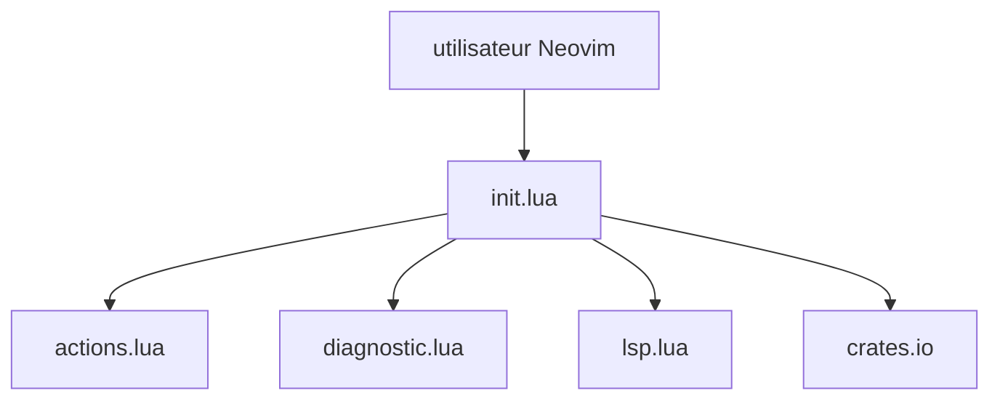

# saecki/crates.nvim

> Neovim plugin to manage crates.io dependencies in Cargo.toml files.

## The problem
Checking whether a Rust dependency is up to date forces you to leave the editor and visit crates.io.

## What it actually does
Install it, then initialize it with `require('crates').setup()`. The tree shows modules for actions, popups, completion, diagnostics, editing, TOML and version semantics, plus LSP and null-ls integrations. Internal calls are not documented here.

## How it is wired


## Trying it
```lua
{
    'saecki/crates.nvim',
    tag = 'stable',
    config = function()
        require('crates').setup()
    end,
}
```

## Cost and gotchas
Free. A stable version (tag) and a development version coexist; a link flags breaking changes.

## What it is not
Not a package manager: it helps edit Cargo.toml, it installs nothing.

## Alternatives
mhinz/vim-crates, shift-d/crates.nvim, kahgeh/ls-crates.nvim and mrcjkb/rustaceanvim, cited as related projects.

## For you
Ignore: only useful if you write Rust in Neovim, outside data / AI / MLOps scope.
