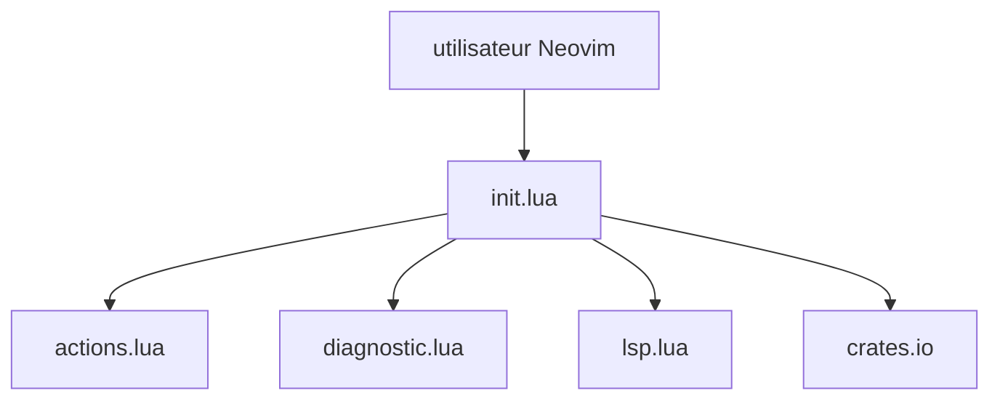

# saecki/crates.nvim

> Plugin Neovim pour gérer les dépendances crates.io dans les fichiers Cargo.toml.

## Le problème
Savoir si une dépendance Rust est à jour oblige à quitter l'éditeur et à consulter crates.io.

## Ce que ça fait vraiment
S'installe puis s'initialise avec `require('crates').setup()`. L'arborescence montre des modules d'actions, de popups, de complétion, de diagnostics, d'édition, de TOML et de sémantique de versions, plus des intégrations LSP et null-ls. Les appels internes ne sont pas documentés ici.

## Comment c'est branché


## Essayer
```lua
{
    'saecki/crates.nvim',
    tag = 'stable',
    config = function()
        require('crates').setup()
    end,
}
```

## Coût et pièges
Gratuit. Une version stable (tag) et une version de développement coexistent ; un lien signale des changements incompatibles.

## Ce que ce n'est pas
Pas un gestionnaire de paquets : il aide à éditer Cargo.toml, il n'installe rien.

## Alternatives
mhinz/vim-crates, shift-d/crates.nvim, kahgeh/ls-crates.nvim et mrcjkb/rustaceanvim, cités comme projets liés.

## Pour toi
Ignorer : utile seulement si tu écris du Rust dans Neovim, hors périmètre data / IA / MLOps.

