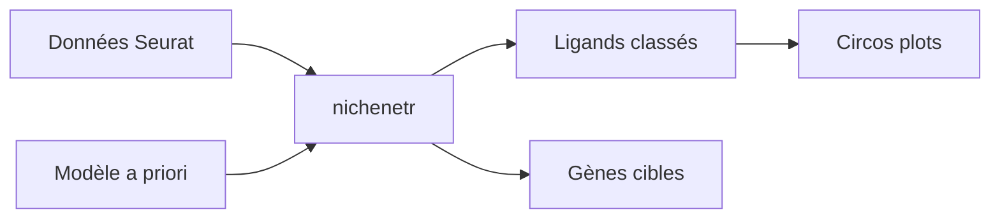

# saeyslab/nichenetr

> R package implementing NicheNet to predict which ligands explain expression changes between cells.

## The problem
Linking a ligand from a sender cell to the genes regulated in a receiver cell, beyond the simple ligand-receptor pair.

## What it actually does
Starts from expression data annotated by cell type (single-cell or bulk, human or mouse) and a prior model combining ligand-receptor pairs, signaling pathways and transcription-factor regulation. Ranks ligands, infers targets and signaling paths, lets you build your own model, and draws circos plots.

## How it is wired


## Trying it
```bash
devtools::install_github("saeyslab/nichenetr")
vignette("seurat_steps", package="nichenetr")
```
(R commands)

## Cost and gotchas
Free. Tested on Windows and Linux, R 4.3.2. No license in the catalog: reuse is not guaranteed. Differential NicheNet is deprecated.

## What it is not
Not a Python version: that one is called nichenetpy.

## Alternatives
MultiNicheNet (multi-sample) and nichenetpy, named in the README.

## For you
Worth watching: only if you do single-cell transcriptomics; the lack of a license is an obstacle to any derived use.
