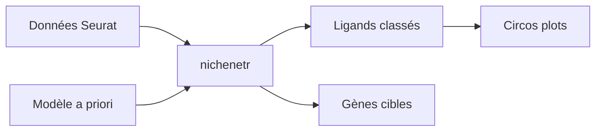

# saeyslab/nichenetr

> Package R implémentant NicheNet pour prédire quels ligands expliquent des changements d'expression entre cellules.

## Le problème
Lier un ligand d'une cellule émettrice aux gènes régulés dans une cellule réceptrice, au-delà du simple couple ligand-récepteur.

## Ce que ça fait vraiment
Part de données d'expression annotées par type cellulaire (single-cell ou bulk, humain ou souris) et d'un modèle a priori combinant ligands-récepteurs, voies de signalisation et régulation par facteurs de transcription. Classe les ligands, infère les cibles et les chemins de signalisation, permet de construire son propre modèle, et trace des circos plots.

## Comment c'est branché


## Essayer
```bash
devtools::install_github("saeyslab/nichenetr")
vignette("seurat_steps", package="nichenetr")
```
(commandes R)

## Coût et pièges
Gratuit. Testé sous Windows et Linux, R 4.3.2. Aucune licence dans le catalogue : réutilisation non garantie. Differential NicheNet déprécié.

## Ce que ce n'est pas
Pas une version Python : celle-ci s'appelle nichenetpy.

## Alternatives
MultiNicheNet (multi-échantillons) et nichenetpy, nommés dans le README.

## Pour toi
À surveiller : seulement si tu fais de la transcriptomique single-cell ; l'absence de licence est un frein à tout usage dérivé.

