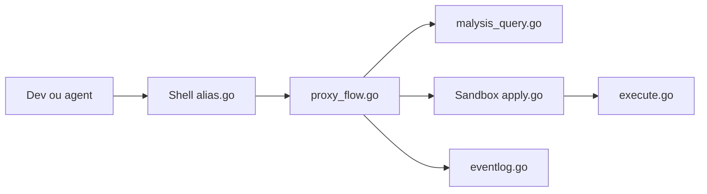

# safedep/pmg

> Install-time firewall that blocks malicious npm and pip packages before they run.

## The problem
Every `npm install` or `pip install` runs unreviewed code; compromises of popular packages keep multiplying.

## What it actually does
Sits in front of npm, pip and poetry (shell alias, proxy): checks each package against SafeDep's free community API, applies a cooldown period on recent versions, can sandbox the installation (Seatbelt, Landlock, Bubblewrap) and keeps a local audit log. A GitHub Action is provided for CI.

## How it is wired


## Trying it
```bash
curl -fsSL https://raw.githubusercontent.com/safedep/pmg/main/install.sh | sh
pmg setup install
pmg setup doctor
npm install --no-cache --prefer-online safedep-test-pkg@0.1.3
```

## Cost and gotchas
Free, no account. Depends on the SafeDep API (package names are sent to them). HTTPS inspection through an injected CA; anonymous telemetry that can be disabled (`PMG_DISABLE_TELEMETRY=true`).

## What it is not
Does not replace fixes for known CVEs (no remediation PRs). Detection is limited to threats already known to the database.

## Alternatives
- safe-chain, Socket: compared in the README (Socket is closed-source, without sandbox).
- Snyk, Dependabot: for CVEs, not install-time blocking.

## For you
Adopt: low-cost protection for you and your agents that install packages, with the trade-off of a call to a third-party API.
