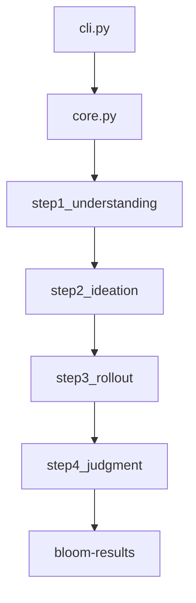

# safety-research/bloom

> Generates evaluation suites for LLM behaviors (sycophancy, self-preservation) from a "seed" configuration.

## The problem
Fixed benchmarks do not probe a specific behavior and go stale; hand-writing varied scenarios takes a long time.

## What it actually does
- Four-step pipeline: understanding, ideation, rollout, judgment.
- Generates scenarios (and variations per dimension), makes the target model converse, then scores the transcripts.
- Conversation or SimEnv (tool calls) modes; interactive chat; Weights & Biases sweeps.
- Models called via LiteLLM.

## How it is wired


## Trying it
```bash
pip install git+https://github.com/safety-research/bloom.git
bloom init
source .env
bloom run bloom-data
```

## Cost and gotchas
API keys for the evaluator and target models are at your expense; the README does not estimate the bill. The repository is frozen: development has moved to Meridian Labs (petri_bloom).

## What it is not
Not maintained here: new features and fixes arrive elsewhere. Not a fixed benchmark: cite the full seed for reproducibility.

## Alternatives
- Meridian Labs version (meridianlabs-ai.github.io/petri_bloom): maintained successor, preferable for a new project.

## For you
Worth watching via the Meridian Labs successor: the idea serves LLM evaluation, but this repository is frozen.
