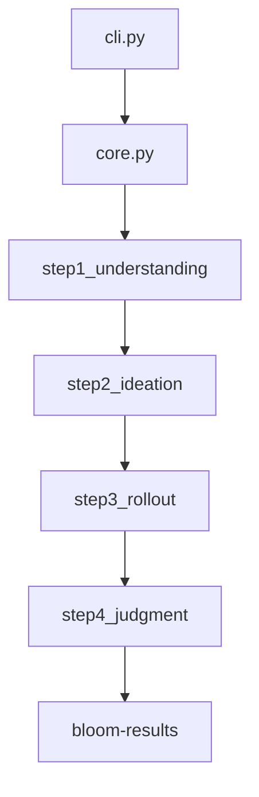

# safety-research/bloom

> Génère des suites d'évaluation de comportements de LLM (complaisance, auto-préservation) à partir d'une configuration « seed ».

## Le problème
Les benchmarks fixes ne sondent pas un comportement précis et se périment ; écrire à la main des scénarios variés est long.

## Ce que ça fait vraiment
- Pipeline en quatre étapes : understanding, ideation, rollout, judgment.
- Génère des scénarios (et des variations par dimension), fait converser le modèle cible, puis note les transcripts.
- Modes conversation ou SimEnv (appels d'outils) ; chat interactif ; sweeps Weights & Biases.
- Modèles appelés via LiteLLM.

## Comment c'est branché


## Essayer
```bash
pip install git+https://github.com/safety-research/bloom.git
bloom init
source .env
bloom run bloom-data
```

## Coût et pièges
Clés d'API des modèles évaluateur et cible à ta charge ; le README ne chiffre pas la facture. Le dépôt est figé : le développement a migré chez Meridian Labs (petri_bloom).

## Ce que ce n'est pas
Pas maintenu ici : les nouveautés et correctifs arrivent ailleurs. Pas un benchmark fixe : citer la seed complète pour la reproductibilité.

## Alternatives
- Version Meridian Labs (meridianlabs-ai.github.io/petri_bloom) : successeur maintenu, à préférer pour un nouveau projet.

## Pour toi
À surveiller via le successeur Meridian Labs : l'idée sert l'évaluation de LLM, mais ce dépôt est gelé.

