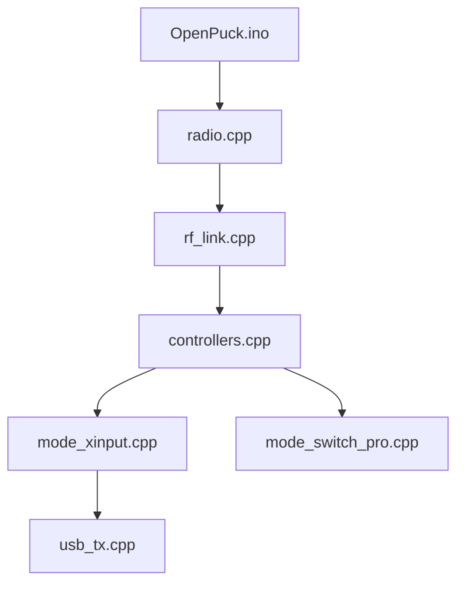

# safijari/openpuck

> nRF52840 firmware that imitates the Steam Controller 2 dongle and emulates several gamepads.

## The problem
The dongle (puck) is not sold separately, and Steam Input is mandatory to use the controller.

## What it actually does
A firmware for the Pro Micro nRF52840 board that receives the controller by radio and presents it over USB as Steam, Xbox 360, Switch Pro, PS3, PS4 and PS5, DirectInput or SInput. Mode selection by button combinations or WebUSB interface, "lizard" mode, rumble adjustment, update through WebUSB. The Xbox 360 mode on a real console remains untested.

## How it is wired


## Trying it
```bash
make uf2 EXTRA_FLAGS="-DOPK_PWR_SWITCH=1"
```
This command enables the ColdBoot option. Otherwise, flash the .uf2 file from the releases onto the board in DFU mode.

## Cost and gotchas
A Pro Micro nRF52840 board (about $8) and a Steam Controller 2 gamepad. The author says they produced the code with LLMs.

## What it is not
Not an official product. The Xbox mode on console is not validated; WebUSB does not work in all modes.

## Alternatives
No alternative named in the README.

## For you
Ignore: gaming accessory, unrelated to data / AI / MLOps work.
