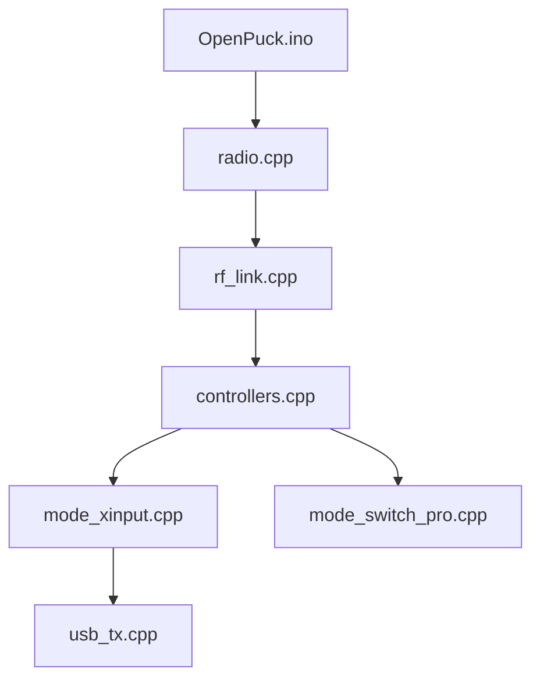

# safijari/openpuck

> Firmware nRF52840 qui imite le dongle du Steam Controller 2 et émule plusieurs manettes.

## Le problème
Le dongle (puck) n'est pas vendu seul, et Steam Input est obligatoire pour utiliser la manette.

## Ce que ça fait vraiment
Un firmware pour carte Pro Micro nRF52840 qui reçoit la manette par radio et la présente en USB comme Steam, Xbox 360, Switch Pro, PS3, PS4 et PS5, DirectInput ou SInput. Choix du mode par combinaisons de boutons ou interface WebUSB, mode « lizard », réglage des vibrations, mise à jour par WebUSB. Le mode Xbox 360 sur vraie console reste non testé.

## Comment c'est branché


## Essayer
```bash
make uf2 EXTRA_FLAGS="-DOPK_PWR_SWITCH=1"
```
Cette commande active l'option ColdBoot. Sinon, flasher le fichier .uf2 des releases sur la carte en mode DFU.

## Coût et pièges
Une carte Pro Micro nRF52840 (environ 8 $) et une manette Steam Controller 2. L'auteur dit avoir produit le code avec des LLM.

## Ce que ce n'est pas
Pas un produit officiel. Le mode Xbox sur console n'est pas validé ; le WebUSB ne marche pas dans tous les modes.

## Alternatives
Aucune alternative nommée dans le README.

## Pour toi
Ignorer : accessoire de jeu, sans lien avec un travail data / IA / MLOps.

