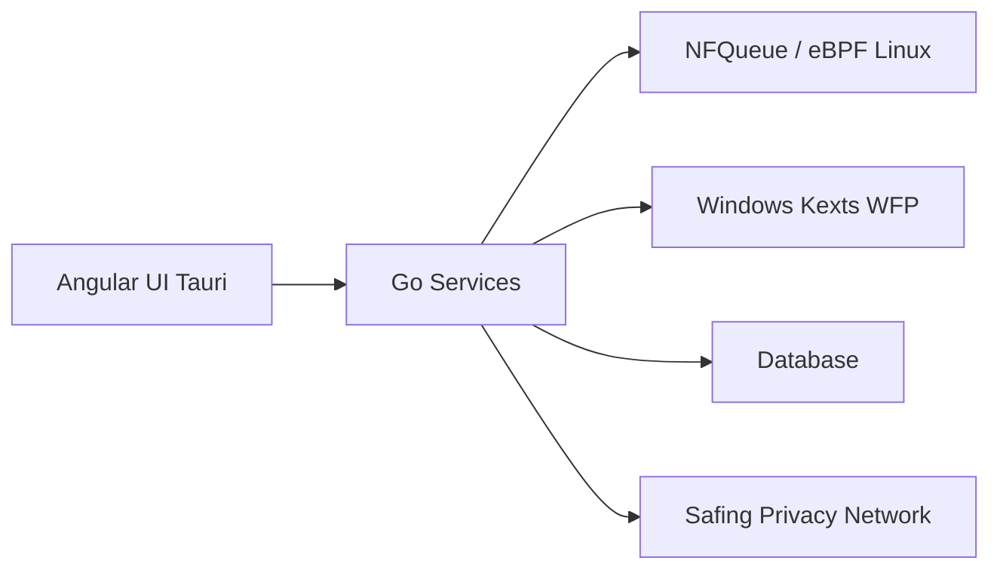

# safing/portmaster

> Open-source application firewall for Windows and Linux that monitors and filters network traffic per application.

## The problem
There is no way to know which applications are communicating, nor to block trackers and malware without manual configuration.

## What it actually does
A Go system service intercepts packets (nfqueue on Linux, WFP driver on Windows) and maps each connection to its application (eBPF, `/proc`). Per-application filters, blocklists, secure DNS over DoH/DoT. Network history, bandwidth tracking and SPN (multi-hop network) are paid ($, $$). Angular interface with Tauri.

## How it is wired


## Trying it
```bash
earthly +release
```
The README flags this build as "WIP" (Earthly and Docker required); normal installation goes through the wiki.

## Cost and gotchas
Basic features are free; history, bandwidth and SPN are paid. The SPN goes through nodes hosted by Safing. The README says the UI still uses Electron.

## What it is not
Not an antivirus nor a VPN: it is a firewall, and the SPN sits between a VPN and Tor.

## Alternatives
No alternative cited in the README.

## For you
Worth watching: useful to see what your AI tools send over the network, but GPL-3.0 copyleft and key features are paid.
