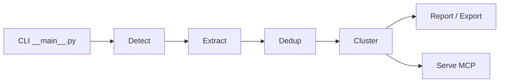

# safishamsi/graphify

> Convert a project (code, documentation, PDF, images) into a queryable knowledge graph, accessible from a code assistant.

## The problem
An assistant reviews or merges the files each time a question is asked, without having a comprehensive overview.

## What it actually does
The code is analyzed locally using tree-sitter, without using a large language model (LLM). Documentation, PDFs, images, and videos are processed through a model. The graph is grouped into communities and written in `graph.json`, `graph.html`, and `GRAPH_REPORT.md`. Each link is labeled as either "EXTRACTED" or "INFERRED". The queries are `query`, `path`, `explain`, and the MCP server.

## How it is wired


## Trying it
```bash
uv tool install graphifyy
graphify install
graphify query "what connects auth to the database?"
graphify hook install
```

## Cost and gotchas
The code itself must be processed offline. For documentation and media, you need either the session model or a key (e.g., Claude, OpenAI, Gemini, Ollama…). The PyPI package is named `graphifyy`. A local log of requests is also provided.

## What it is not
This is not a vector index: there are no embeddings. The INFERRED links are deductions, not facts. The catalog does not state any license.

## Alternatives
The benchmark compares with mem0 and supermemory for memory.

## For you
To be used as a trial version based on source code: the "code-only" mode is local and free, and the graph helps to explore an unfamiliar project.
