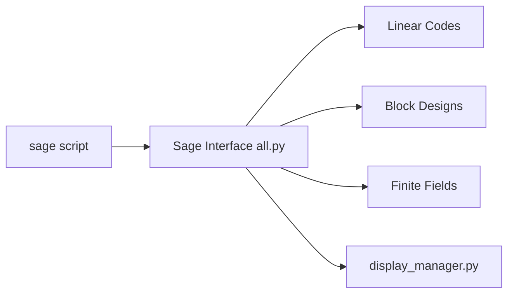

# sagemath/sage

> Open-source mathematics system, an alternative to Magma, Maple, Mathematica and MATLAB.

## The problem
Commercial computer algebra software is expensive and closed.

## What it actually does
A mathematical software distribution: a Python/Cython library (algebra, combinatorics, coding theory, finite fields...) and dependencies compiled by a package system (SPKG). The README mostly describes compiling from source; GPLv2+ is stated in the text. Python 3.12 to 3.14 required, plus more than 10 GB of disk.

## How it is wired


## Trying it
```bash
git clone -c core.symlinks=true --filter blob:none --origin upstream --branch develop --tags https://github.com/sagemath/sage.git
cd sage
make configure
./configure
make
./sage
```

## Cost and gotchas
Compilation takes about an hour on a recent machine, 10 GB free, 5 GB of RAM for WSL; do not compile as root. Docker image `sagemath/sagemath` available.

## What it is not
Not a lightweight pip package. The license is flagged "unidentified" by GitHub while the README states GPLv2+.

## Alternatives
No alternative named; the README cites Docker or the cloud to avoid compiling.

## For you
To watch: useful for symbolic computation or coding theory needs, but the heavy installation is rarely justified for everyday ML.
