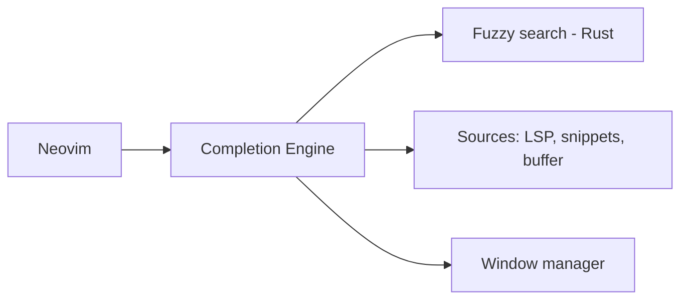

# saghen/blink.cmp

> Completion plugin for Neovim (LSP, cmdline, snippets), for Neovim users.

## The problem
Built-in completion is limited and the alternatives are slower or more complex to configure.

## What it actually does
LSP completion, command line, terminal (0.11+), signature help (experimental), native snippets, LuaSnip or mini.snippets, external sources including an nvim-cmp compatibility layer. Optional Rust fuzzy matcher, typo-tolerant, advertised latency of 0.5 to 4 ms. V2 introduces breaking changes and requires `blink.lib`.

## How it is wired
No component readable in the supplied graph; diagram not reproduced. From the explanation: completion engine, Rust fuzzy matcher, sources, windows, configuration.



## Trying it
The README refers to the V1 documentation site for installation; an excerpt suggests `version = "1.*"` in lazy.nvim.

```bash
# non documenté dans le README
```

## Cost and gotchas
Free. Choose the stable V1; V2 breaks compatibility.

## What it is not
Not an AI assistant: code completion only.

## Alternatives
nvim-cmp is cited as a comparison: it is the other reference completion plugin for Neovim, which blink.cmp aims to replace by being faster.

## For you
Ignore unless you use Neovim: editing comfort, nothing specific to data/AI.
