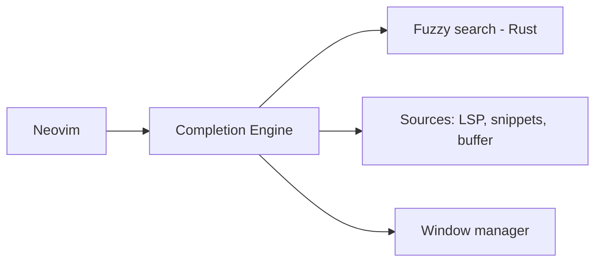

# saghen/blink.cmp

> Plugin de complétion pour Neovim (LSP, cmdline, snippets), pour utilisateurs de Neovim.

## Le problème
La complétion intégrée est limitée et les alternatives sont plus lentes ou plus complexes à régler.

## Ce que ça fait vraiment
Complétion LSP, ligne de commande, terminal (0.11+), aide à la signature (expérimental), snippets natifs, LuaSnip ou mini.snippets, sources externes dont une couche de compatibilité nvim-cmp. Fuzzy matcher optionnel en Rust, tolérant aux fautes de frappe, latence annoncée de 0,5 à 4 ms. La V2 introduit des changements incompatibles et exige `blink.lib`.

## Comment c'est branché
Aucun composant lisible dans le graphe fourni ; schéma non reproduit. D'après l'explication : moteur de complétion, fuzzy Rust, sources, fenêtres, configuration.



## Essayer
Le README renvoie au site de documentation V1 pour l'installation ; un extrait suggère `version = "1.*"` dans lazy.nvim.

```bash
# non documenté dans le README
```

## Coût et pièges
Gratuit. Choisir la V1 stable ; la V2 casse la compatibilité.

## Ce que ce n'est pas
Pas un assistant IA : uniquement de la complétion de code.

## Alternatives
nvim-cmp est cité en comparaison.

## Pour toi
À ignorer sauf si tu es sous Neovim : confort d'édition, rien de spécifique à data/IA.

