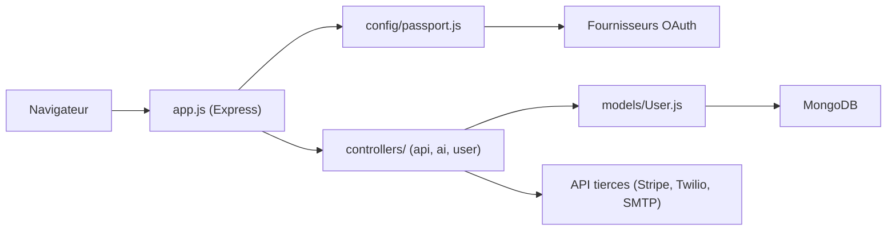

# sahat/hackathon-starter

> Node.js/Express web application template with authentication, third-party API examples and AI demos, to kick-start a hackathon.

## The problem
Starting a web project takes hours: choosing the framework, OAuth, contact form, user accounts. Without a common base, the team cannot contribute right away.

## What it actually does
Provides an Express application (MVC, Pug views, Bootstrap 5.3) with local login, passkey, 2FA and OAuth (Google, GitHub, Microsoft…). The User model is stored in MongoDB via Mongoose. Controllers showcase about twenty third-party APIs (Stripe, Twilio, Google Drive…). On the AI side: a LangChain/LangGraph ReAct agent with MongoDB sessions, input guardrails and SSE streaming, plus a RAG example.

## How it is wired


## Trying it
```bash
git clone https://github.com/sahat/hackathon-starter.git myproject
cd myproject
npm install
npm start
```

## Cost and gotchas
Local MongoDB or Atlas; the README specifies that the vector search of the AI examples requires Atlas, not a local MongoDB. Each third-party API requires its own account and key (some with a credit card, e.g. HERE Maps); the AI agent uses Groq.

## What it is not
Not a framework to depend on: you clone and modify. The keys in the repository are placeholders, and the README points to a separate checklist (PROD_CHECKLIST.md) before any production deployment. The README describes all routes in app.js as a choice of simplicity.

## Alternatives
No alternative cited in the README.

## For you
Worth watching: useful as a starting point for a web demo with a LangChain agent and RAG, but a Node/Mongo stack and coupling to Groq, far from an MLOps foundation.
