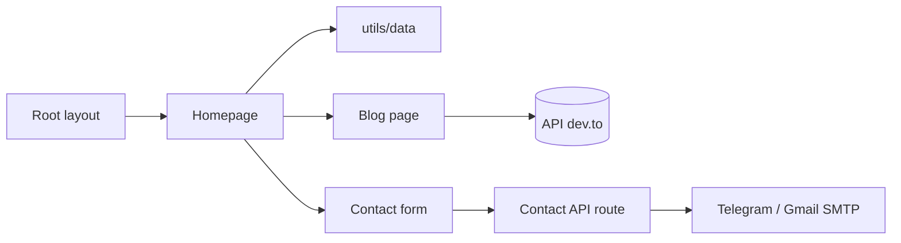

# said7388/developer-portfolio

> Portfolio website template for developers and freelancers, built with Next.js 16 and Tailwind.

## The problem
A developer who wants an online portfolio often starts from scratch for the layout, the blog and the contact form.

## What it actually does
A Next.js template (App Router, React 19, Tailwind 4) driven by data files (`personal-data.js`, `projects-data.js`, etc.). It offers hero, experience, skills and projects sections, a blog fed by dev.to, a contact form with Telegram and Gmail e-mail notification (nodemailer), and optional reCAPTCHA and Google Tag Manager. Deployment on Vercel, Netlify or Docker.

## How it is wired


## Trying it
```bash
git clone https://github.com/<YOUR_GITHUB_USERNAME>/developer-portfolio.git
cd developer-portfolio
pnpm install
cp .env.example .env
pnpm dev
docker-compose up --build
```

## Cost and gotchas
Node 18.17+ (20+ recommended). The form requires a Telegram token or a Gmail app password. No license declared: reuse is legally uncertain.

## What it is not
Not a professional tool: it is a personal template to fill in with your own data. No documented tests.

## Alternatives
No alternative named in the README.

## For you
Ignore: a web template unrelated to data or AI, and with no declared license.
