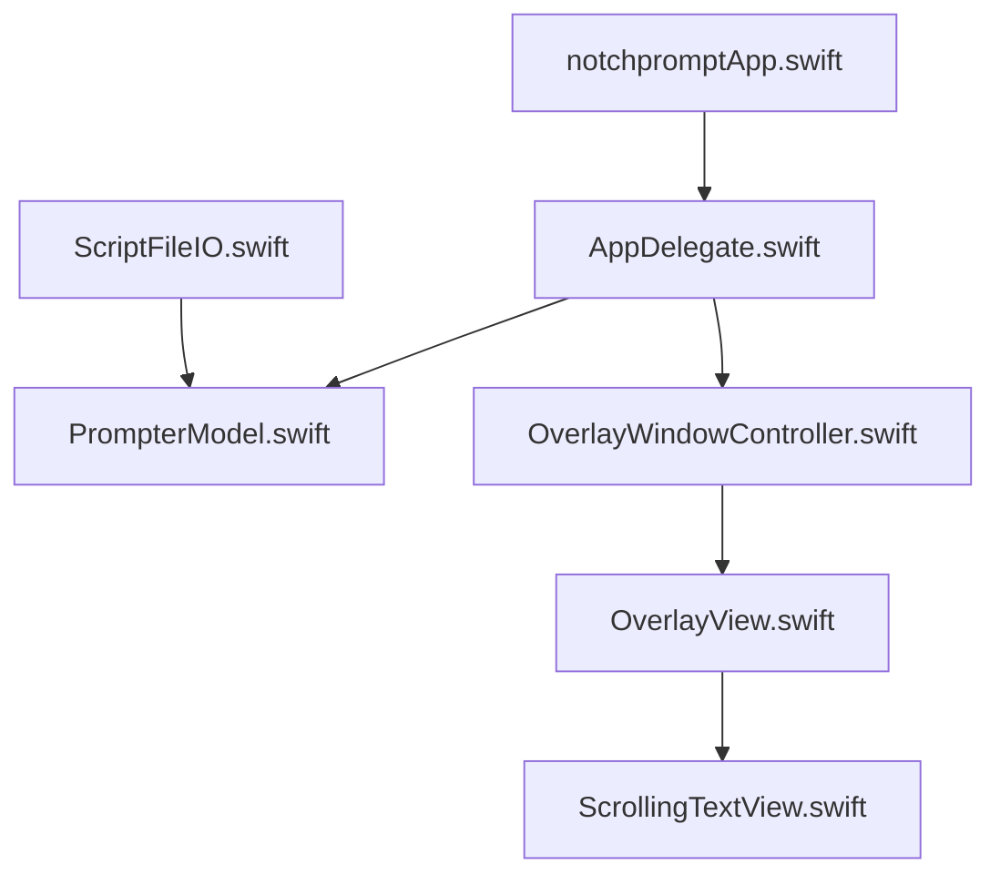

# saif0200/notchprompt

> Native macOS teleprompter displayed near the notch, for presentations and recordings.

## The problem
Reading a script while looking at the camera is hard; a scroll placed near the notch keeps your gaze close to the lens.

## What it actually does
A menu bar application with a floating panel: start, pause, 5 s rewind, adjustable speed, font size and dimensions, optional countdown, import and export of text scripts. A private mode tries to hide the window from screen sharing (depending on the application).

## How it is wired


## Trying it
```bash
xattr -cr /Applications/notchprompt.app
open /Applications/notchprompt.app
xcodebuild -project notchprompt.xcodeproj -scheme notchprompt -configuration Debug build
```

## Cost and gotchas
Free. Unsigned and non-notarized build: macOS shows warnings. The demo images are placeholders.

## What it is not
Not a cross-platform tool (macOS only); the private mode is only a best-effort attempt.

## Alternatives
No alternative named in the README.

## For you
Ignore: useful for presenting demos, but outside the data, AI or MLOps scope, and unsigned.
