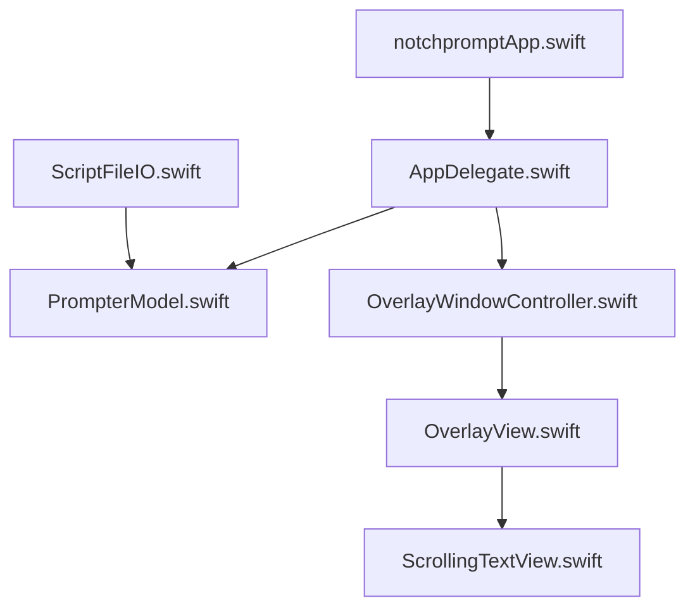

# saif0200/notchprompt

> Téléprompteur natif macOS affiché près de l'encoche, pour présentations et enregistrements.

## Le problème
Lire un script en regardant la caméra est difficile ; un défilement placé près de l'encoche garde le regard proche de l'objectif.

## Ce que ça fait vraiment
Une application de barre de menus avec un panneau flottant : démarrage, pause, retour de 5 s, vitesse, taille de police et dimensions réglables, compte à rebours optionnel, import et export de scripts texte. Un mode privé tente de masquer la fenêtre au partage d'écran (selon les applications).

## Comment c'est branché


## Essayer
```bash
xattr -cr /Applications/notchprompt.app
open /Applications/notchprompt.app
xcodebuild -project notchprompt.xcodeproj -scheme notchprompt -configuration Debug build
```

## Coût et pièges
Gratuit. Build non signé et non notarisé : macOS affiche des avertissements. Les images de démonstration sont des espaces réservés.

## Ce que ce n'est pas
Pas un outil multiplateforme (macOS seulement) ; le mode privé n'est qu'un effort de bonne foi.

## Alternatives
Aucune alternative nommée dans le README.

## Pour toi
Ignorer : utile pour présenter des démos, mais hors périmètre data, IA ou MLOps, et non signé.

