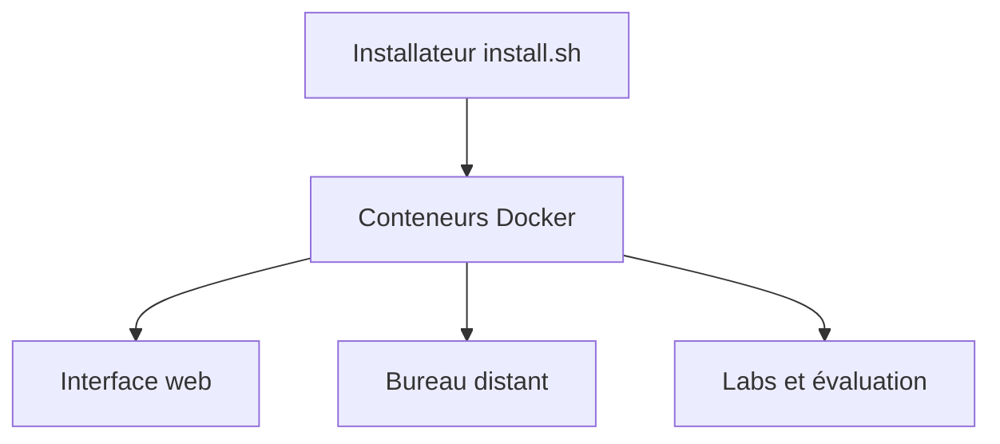

# sailor-sh/CK-X

> Kubernetes exam simulator (CKAD, CKA, CKS) in Docker, for anyone preparing for a certification.

## The problem
Practicing for Kubernetes exams without realistic conditions: no timer, no automatic grading, no remote desktop.

## What it actually does
It launches a web environment with a remote desktop and hands-on labs for CKAD, CKA and CKS. An evaluation system checks solutions in real time and a timed mode imitates the exam. Deployment relies on Docker, with K3D and DIND credited in the acknowledgements.

## How it is wired
Simplified diagram based on the sheet, no diagram provided.



## Trying it
```bash
curl -fsSL https://raw.githubusercontent.com/sailor-sh/CK-X/master/scripts/install.sh | bash
```
On Windows: `irm https://raw.githubusercontent.com/sailor-sh/CK-X/master/scripts/install.ps1 | iex`, with WSL2 enabled in Docker Desktop.

## Cost and gotchas
Free, but it runs a remote script via curl and requires Docker. A license is present but not identified by GitHub: read it before any use.

## What it is not
Not affiliated with the CNCF, the Linux Foundation or PSI, and no guarantee of passing the exam. It is not a course: only labs.

## Alternatives
No named alternative in the README.

## For you
Watch: relevant if you are taking a Kubernetes certification for MLOps, of no interest otherwise, and the license remains to be checked.
