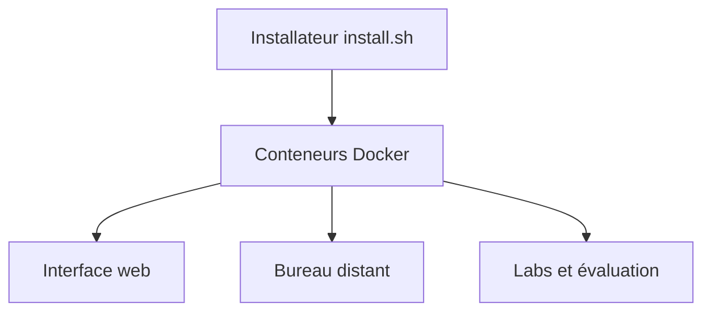

# sailor-sh/CK-X

> Simulateur d'examen Kubernetes (CKAD, CKA, CKS) en Docker, pour qui prépare une certification.

## Le problème
S'entraîner aux examens Kubernetes sans conditions réalistes : pas de chrono, pas de correction automatique, pas de bureau distant.

## Ce que ça fait vraiment
Il lance un environnement web avec bureau distant et des labs pratiques pour CKAD, CKA et CKS. Un système d'évaluation vérifie les solutions en temps réel et un mode chronométré imite l'examen. Le déploiement repose sur Docker, avec K3D et DIND cités en remerciements.

## Comment c'est branché
Schéma simplifié d'après la fiche, sans diagramme fourni.



## Essayer
```bash
curl -fsSL https://raw.githubusercontent.com/sailor-sh/CK-X/master/scripts/install.sh | bash
```
Sous Windows : `irm https://raw.githubusercontent.com/sailor-sh/CK-X/master/scripts/install.ps1 | iex`, avec WSL2 activé dans Docker Desktop.

## Coût et pièges
Gratuit, mais il exécute un script distant via curl et exige Docker. Licence présente mais non identifiée par GitHub : à lire avant tout usage.

## Ce que ce n'est pas
Non affilié à la CNCF, à la Linux Foundation ou à PSI, et sans garantie de réussite à l'examen. Ce n'est pas un cours : seulement des labs.

## Alternatives
Aucune alternative nommée dans le README.

## Pour toi
À surveiller : pertinent si tu passes une certification Kubernetes pour du MLOps, sans intérêt autrement, et la licence reste à vérifier.

