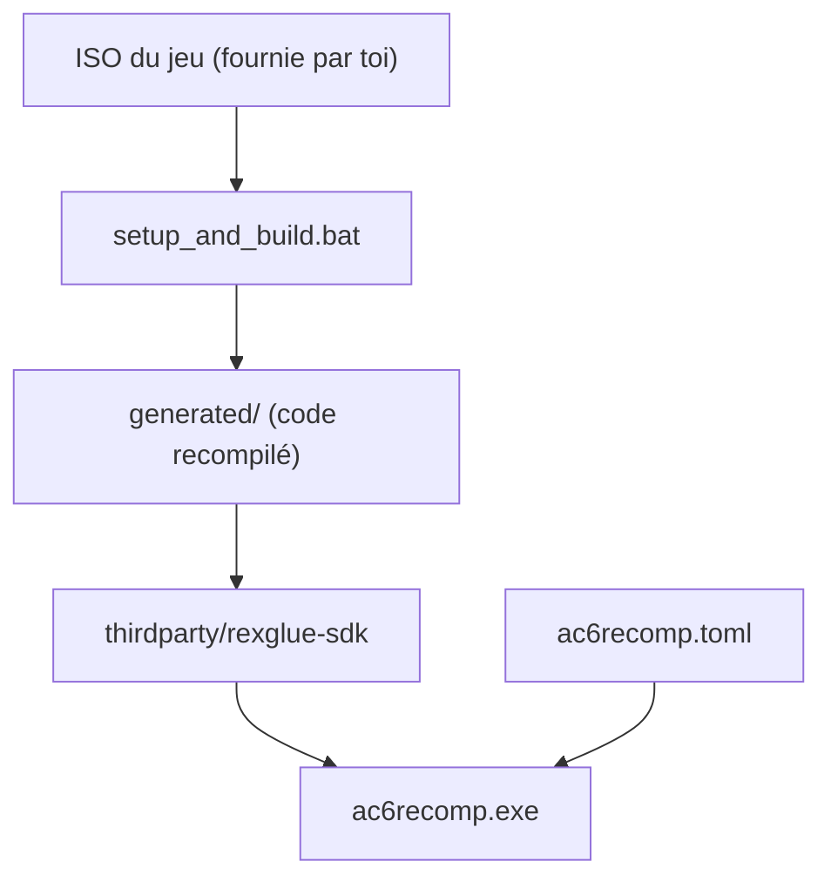

# sal063/AC6_recomp

> Native PC port of Ace Combat 6, statically recompiled from the Xbox 360 code, for Windows players.

## The problem
The game exists only on Xbox 360, at 30 frames per second.

## What it actually does
Recompiles the Xbox 360 PowerPC code into x86-64 on the ReXGlue SDK; rendering is left to the RexGlue/Xenia graphics backend. Adds 60 fps, full-resolution terrain, upscaling, ultrawide, mouse and keyboard, Japanese text, texture replacement. Unofficial project: the repository contains no game data.

## How it is wired
Simplified diagram based on the sheet, no diagram provided.


## Trying it
```bash
cmake --preset win-amd64-relwithdebinfo
cmake --build --preset win-amd64-relwithdebinfo --target ac6recomp_codegen
cmake --preset win-amd64-relwithdebinfo
cmake --build --preset win-amd64-relwithdebinfo
```

## Cost and gotchas
Free, but you must own the game (US region only). Windows 10/11, CPU with AVX2, powerful Direct3D 12 GPU. Bugs and crashes announced.

## What it is not
It is not a distribution of the game, and it is not stable. The repository forbids committing game data.

## Alternatives
No alternative named in the README.

## For you
Ignore: a game port unrelated to data / AI / MLOps.
