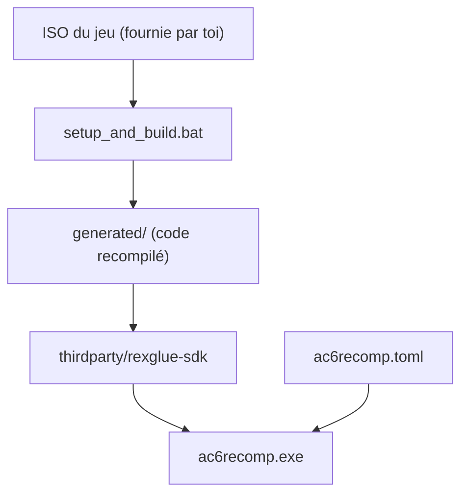

# sal063/AC6_recomp

> Portage PC natif d'Ace Combat 6, recompilé statiquement depuis le code Xbox 360, pour joueurs Windows.

## Le problème
Le jeu n'existe que sur Xbox 360, en 30 images par seconde.

## Ce que ça fait vraiment
Recompile le code PowerPC Xbox 360 en x86-64 sur le SDK ReXGlue ; le rendu reste confié au backend graphique RexGlue/Xenia. Ajoute 60 fps, terrain en pleine résolution, mise à l'échelle, ultra-large, souris et clavier, texte japonais, remplacement de textures. Projet non officiel : le dépôt ne contient aucune donnée de jeu.

## Comment c'est branché
Schéma simplifié d'après la fiche, sans diagramme fourni.


## Essayer
```bash
cmake --preset win-amd64-relwithdebinfo
cmake --build --preset win-amd64-relwithdebinfo --target ac6recomp_codegen
cmake --preset win-amd64-relwithdebinfo
cmake --build --preset win-amd64-relwithdebinfo
```

## Coût et pièges
Gratuit, mais il faut posséder le jeu (région US uniquement). Windows 10/11, CPU avec AVX2, GPU Direct3D 12 puissant. Bugs et plantages annoncés.

## Ce que ce n'est pas
Ce n'est pas une distribution du jeu, et ce n'est pas stable. Le dépôt interdit de commiter les données du jeu.

## Alternatives
Aucune alternative nommée dans le README.

## Pour toi
À ignorer : un portage de jeu sans rapport avec data / IA / MLOps.

