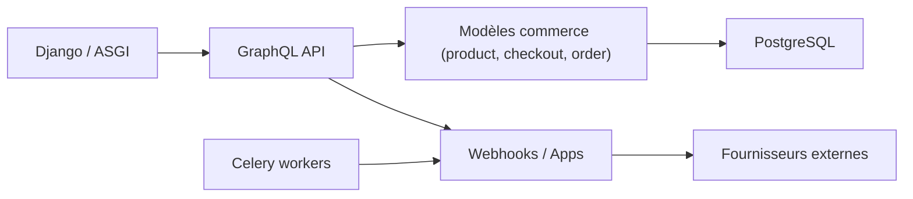

# saleor/saleor

> Headless e-commerce back end, GraphQL only, multi-channel, for teams building a custom store.

## The problem
Monolithic e-commerce platforms impose their technical stack and their plugins.

## What it actually does
Exposes a GraphQL API on a Django core: catalog, multi-warehouse stock, cart, orders, promotions, payments, taxes, shipping. Extended through webhooks, installed apps and plugins. From the code: ASGI, PostgreSQL, Celery tasks, Redis/SQS, Stripe, AvaTax and SendGrid adapters. The dashboard and the storefront are separate repositories. The `main` branch may be unstable.

## How it is wired


## Trying it
```bash
npm i -g @saleor/cli
saleor register
saleor storefront create --url {your-saleor-graphql-endpoint}
```

## Cost and gotchas
The code is free, but running it (PostgreSQL, Redis, workers, payments) is on you; Saleor Cloud is the fast path. The README admits that the services-based approach is heavier for a small shop.

## What it is not
Not a ready-to-use storefront, nor a classic CMS.

## Alternatives
WordPress and Magento are cited as the traditional approach, faster to get started with.

## For you
Ignore: e-commerce platform with no link to data or AI.
