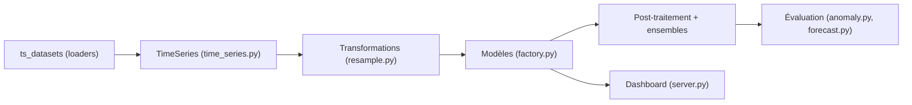

# salesforce/Merlion

> Python time series library: forecasting, anomaly detection and change point detection; archived.

## The problem
Comparing time series models across datasets requires heterogeneous interfaces and evaluation pipelines.

## What it actually does
A unified interface for statistical, tree-based and deep learning models in forecasting, anomaly detection and change point detection, univariate or multivariate. Provides `DefaultDetector` and `DefaultForecaster`, AutoML, exogenous regressors, post-processing of anomaly scores, ensembles, evaluation simulating periodic retraining, visualization, a clickable dashboard and a PySpark backend. `ts_datasets` loads NAB, M4, etc.

## How it is wired


## Trying it
```bash
pip install salesforce-merlion
pip install "salesforce-merlion[dashboard]"
python -m merlion.dashboard
python benchmark_forecast.py --dataset M4_Hourly --model ETS
```

## Cost and gotchas
Free. External dependencies: OpenMP (lightgbm) and JDK 11 for some detectors. Archived repository (last push March 2026): no more maintenance, risk of incompatibility with recent numpy/pandas versions.

## What it is not
No GPU support (the README lists it as "coming soon", in an archived project). The comparisons in the table with Prophet, Kats, darts etc. come from the authors.

## Alternatives
Prophet, Kats, darts, statsmodels, nixtla, GluonTS, STUMPY (columns of the README's comparison table).

## For you
Useful to read the "simulated deployment" evaluation approach or to reproduce results; for a new project, prefer a maintained library.
